# GraphFlow — ER Diagram (implemented schema)

Renders on GitHub, VS Code (Markdown Preview Mermaid) and https://mermaid.live. A browser viewer is in `docs/er-diagram.html`.
Crow's-foot notation: `||` exactly one · `o|` zero or one · `o{` zero or many · `|{` one or many.

```mermaid
erDiagram
    organizations ||--o| organization_settings : "configured by"
    organizations ||--o{ users : employs
    organizations ||--o{ teams : has
    organizations ||--o{ projects : owns
    organizations ||--o{ tools : defines
    organizations ||--o{ devices : registers

    teams ||--o{ users : "has members"
    users ||--o{ teams : "manages"
    teams ||--o{ projects : "works on"
    users ||--o{ projects : "project manager of"

    projects ||--o{ project_members : "staffed by"
    users ||--o{ project_members : "assigned as"
    projects ||--o| project_billing_configs : "billed by rules"

    tools ||--o{ files : "opens"
    projects ||--o{ files : "contains"
    users ||--o{ files : "created"

    users ||--o{ devices : "owns"
    users ||--o{ auth_sessions : "logs in with"
    users ||--o{ password_reset_tokens : "requests"
    users ||--o{ invitations : "sends"

    devices ||--o{ activity_sessions : "runs"
    users ||--o{ activity_sessions : "works in"
    projects ||--o{ activity_sessions : "mainly on"

    activity_sessions ||--o{ raw_activity_events : "receives"
    raw_activity_events ||--o| activity_event_inbox : "tracked by"
    simulation_runs ||--o{ raw_activity_events : "generates"
    users ||--o{ simulation_runs : "starts"
    users ||--o{ simulation_runs : "is simulated in"

    activity_sessions ||--o{ focus_events : "reconstructed into"
    users ||--o{ focus_events : "performs"
    projects ||--o{ focus_events : "attributed to"
    tools ||--o{ focus_events : "uses"
    files ||--o{ focus_events : "edits"

    users ||--o{ collaboration_links : "source"
    users ||--o{ collaboration_links : "target"
    projects ||--o{ collaboration_links : "on"

    users ||--o{ timesheets : "submits"
    projects ||--o{ timesheets : "billed in"
    users ||--o{ timesheets : "reviews"
    timesheets ||--o{ billing_adjustments : "changed by"
    users ||--o{ billing_adjustments : "adjusts"
    projects ||--o{ billable_audits : "snapshotted in"
    users ||--o{ audit_logs : "acts in"

    organizations {
        uuid id PK
        text name
        text slug UK
        text timezone
        boolean is_demo
    }
    organization_settings {
        uuid organization_id PK,FK
        int deep_focus_min_minutes
        int idle_timeout_minutes
        int heartbeat_timeout_minutes
        int budget_alert_threshold_pct
        int raw_event_retention_days
    }
    users {
        uuid id PK
        uuid organization_id FK
        uuid team_id FK
        text email UK
        text password_hash
        enum role
        boolean is_active
        boolean tracking_consent
        timestamptz consent_updated_at
    }
    teams {
        uuid id PK
        uuid organization_id FK
        uuid manager_id FK
        text name
    }
    auth_sessions {
        uuid id PK
        uuid user_id FK
        text token_hash UK
        timestamptz expires_at
        timestamptz revoked_at
    }
    password_reset_tokens {
        uuid id PK
        uuid user_id FK
        text token_hash UK
        timestamptz used_at
    }
    invitations {
        uuid id PK
        uuid invited_by_id FK
        text email
        enum role
        text token_hash UK
    }
    projects {
        uuid id PK
        uuid organization_id FK
        uuid team_id FK
        uuid project_manager_id FK
        text name
        decimal budget_hours
        decimal hourly_rate
        enum status
        date deadline
    }
    project_members {
        uuid id PK
        uuid project_id FK
        uuid user_id FK
        text assigned_role
    }
    project_billing_configs {
        uuid project_id PK,FK
        enum_array billable_categories
        boolean collaboration_billable
        boolean administrative_billable
        enum rounding_rule
        boolean requires_approval
    }
    tools {
        uuid id PK
        uuid organization_id FK
        text name
        enum category
        text executable_name
        boolean default_billable_status
    }
    files {
        uuid id PK
        uuid project_id FK
        uuid tool_id FK
        uuid created_by FK
        text file_name
        text file_path
    }
    devices {
        uuid id PK
        uuid user_id FK
        text name
        boolean is_simulated
        text token_hash UK
    }
    activity_sessions {
        uuid id PK
        uuid user_id FK
        uuid device_id FK
        uuid project_id FK
        enum status
        timestamptz started_at
        int tracked_seconds
        int deep_focus_seconds
    }
    raw_activity_events {
        uuid id PK
        uuid session_id FK
        uuid simulation_run_id FK
        uuid client_event_id UK
        enum event_type
        timestamptz event_timestamp
        jsonb payload
        enum processing_status
        int attempts
    }
    activity_event_inbox {
        uuid id PK
        uuid source_event_id FK,UK
        enum processing_status
        int attempts
        timestamptz enqueued_at
    }
    focus_events {
        uuid id PK
        uuid session_id FK
        uuid user_id FK
        uuid project_id FK
        uuid tool_id FK
        uuid file_id FK
        timestamptz started_at
        timestamptz ended_at
        int duration_seconds
        enum activity_category
        boolean is_billable
        boolean is_context_switch
    }
    collaboration_links {
        uuid id PK
        uuid source_user_id FK
        uuid target_user_id FK
        uuid project_id FK
        int duration_seconds
        text interaction_type
    }
    simulation_runs {
        uuid id PK
        uuid actor_id FK
        uuid user_id FK
        text scenario
        int speed
        enum status
    }
    timesheets {
        uuid id PK
        uuid user_id FK
        uuid project_id FK
        uuid reviewed_by FK
        timestamptz reporting_period_start
        int billable_seconds
        decimal hourly_rate
        decimal billable_amount
        enum status
    }
    billing_adjustments {
        uuid id PK
        uuid timesheet_id FK
        uuid adjusted_by FK
        int previous_billable_seconds
        int adjusted_billable_seconds
        text reason
    }
    billable_audits {
        uuid id PK
        uuid project_id FK
        timestamptz reporting_period_start
        int total_billable_seconds
        int approved_billable_seconds
        decimal billable_amount
    }
    audit_logs {
        uuid id PK
        uuid actor_id FK
        text action
        text entity_type
        jsonb metadata
        text request_id
    }
```

## How to read it

1. **Tenant:** `organizations` owns everything. Every other table also carries `organization_id` (omitted from most boxes above to keep the diagram readable) and is protected by Row-Level Security.
2. **People:** `users` belong to a `team`; a user can also *manage* a team (two relationships between the same entities).
3. **Work:** `projects` ← `project_members` → `users` is a many-to-many link.
4. **Collection pipeline:** `devices` → `activity_sessions` → `raw_activity_events` (JSONB, one ledger row each in `activity_event_inbox`) → worker → `focus_events`.
5. **Billing:** `focus_events` roll up into `timesheets` per user and project; changes are kept in `billing_adjustments`; `audit_logs` records every important action.
6. **Not a foreign key:** `timesheets` are generated from `focus_events` by a query, so no direct link exists between them.
